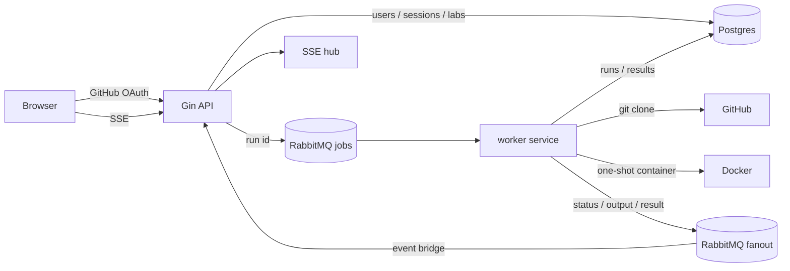

# Docpine

Docpine runs repository-backed coding labs. A user signs in with GitHub, selects a repository, starts a lab, and watches build/test output stream over Server-Sent Events while a separate worker service clones the repository and executes the lab's commands in an isolated Docker container.

## Architecture at a glance



The API never talks to Docker. Only the worker service mounts `/var/run/docker.sock` and spawns containers.

## Run lifecycle

1. `POST /v1/auth/login` starts GitHub OAuth and sets an `oauth_state` cookie.
2. `GET /v1/auth/callback` exchanges the code, creates the user/session, and sets a `session` cookie.
3. `PUT /v1/me/repo` saves the normalized GitHub repository for the user.
4. `POST /v1/labs/{id}/runs` creates a `lab_run` and publishes its id to the RabbitMQ jobs queue.
5. The worker service consumes the job, clones the repository, copies it into a temporary container filesystem, and runs each configured lab command with `/bin/sh -c`.
6. The worker persists the final `lab_result` and publishes status/output/result events to a RabbitMQ fanout exchange.
7. The API consumes that exchange, feeds its in-memory SSE hub, and streams events to `GET /v1/labs/{id}/runs/{runID}/events`.

## Requirements

- Go 1.26+
- PostgreSQL 16
- RabbitMQ 3
- Docker Engine reachable by the worker service
- A GitHub OAuth application
- Optional Cloudflare Turnstile keys

## Quick start

```bash
cp .env.example .env
```

Set `GITHUB_CLIENT_ID`, `GITHUB_CLIENT_SECRET`, `GITHUB_CALLBACK_URL`, and a real `COOKIE_SECRET`. Then start the stack:

```bash
docker compose up -d --build
```

Migrations run automatically through the `migrate` service. The API is available on `http://localhost:8080`, the frontend on `http://localhost:3000`, and the worker runs as `worker`.

Seed at least one lab before creating runs:

```sql
INSERT INTO labs (name, tests)
VALUES ('smoke', ARRAY['echo hello', 'test -f README.md']);
```

## API overview

Full request/response definitions are in [`openapi.yaml`](openapi.yaml).

| Method | Path | Description |
| --- | --- | --- |
| `GET` | `/healthz` | Liveness probe |
| `GET`, `POST` | `/v1/auth/login` | Start GitHub OAuth |
| `GET`, `POST` | `/v1/auth/callback` | Complete GitHub OAuth |
| `POST` | `/v1/auth/logout` | Delete session and clear cookies |
| `GET` | `/v1/me` | Current user |
| `GET`, `PUT` | `/v1/me/repo` | Read or save the user's GitHub repository |
| `GET` | `/v1/labs` | List available labs |
| `POST`, `GET` | `/v1/labs/{id}/runs` | Create or list runs for a lab |
| `GET` | `/v1/labs/{id}/runs/{runID}` | Read one run |
| `GET` | `/v1/labs/{id}/runs/{runID}/result` | Read persisted output |
| `GET` | `/v1/labs/{id}/runs/{runID}/events` | SSE stream for a run |

All `/v1` endpoints except auth use the `session` cookie. `POST /v1/auth/login` and `POST /v1/labs/{id}/runs` also accept `CF-Turnstile-Response` when Turnstile is enabled.

## Configuration

| Variable | Purpose | Default |
| --- | --- | --- |
| `ADDR`, `PORT` | HTTP bind address | `0.0.0.0:8080` |
| `COOKIE_SECRET` | Signs session tokens | required by API and worker config |
| `GITHUB_CLIENT_ID`, `GITHUB_CLIENT_SECRET` | OAuth app credentials | required for login |
| `GITHUB_CALLBACK_URL` | OAuth redirect URL | `http://localhost:8080/v1/auth/callback` |
| `GITHUB_FORCE_SECURE` | Emit `Secure` cookies | `false` |
| `ALLOWED_ORIGINS` | Comma-separated CORS origins | empty |
| `DATABASE_URL` | PostgreSQL DSN | local compose-style DSN |
| `RABBITMQ_URL` | AMQP connection | local compose-style URL |
| `RABBITMQ_QUEUE` | Job queue name | `docpine.lab.runs` |
| `RABBITMQ_EVENTS_EXCHANGE` | Worker-to-API event fanout | `docpine.lab.events` |
| `LAB_RUNNER_IMAGE` | Image used for lab commands | `alpine:3.20` |
| `LAB_RUN_TIMEOUT` | Per-run deadline | `10m` |
| `LAB_MEMORY` | Container memory limit in bytes | `268435456` |
| `LAB_CPU_SHARES` | Container CPU shares | `0` |
| `TURNSTILE_SECRET` | Cloudflare Turnstile secret | empty disables checks |
| `LOG_DIR`, `LOG_LEVEL` | File logging and level | empty, `info` |

`LAB_*` settings are used by the worker only. `RUNTIME_NAME`, `SESSION_TTL`, `RATE_LIMIT_*`, and Firecracker/gVisor settings from the previous sandbox design are no longer used.

## Worker behavior

- The worker is a separate binary (`cmd/worker`) and consumes jobs with prefetch 1.
- Only the worker container mounts the host Docker socket; the API has no Docker client.
- Repositories are normalized to `https://github.com/owner/repo.git`.
- Files are copied into `/tmp/workspace` inside the container through the Docker API, so no host bind mount of a worker-local path is required.
- Lab containers run with network mode `none`, a memory limit, CPU shares, and a timeout.
- The runner image is pulled automatically if it is not already present on the Docker host.
- Use an image that provides the toolchains your labs need; `alpine:3.20` only includes a POSIX shell and core tools.

## SSE across services

Worker events are published to the durable RabbitMQ fanout exchange `RABBITMQ_EVENTS_EXCHANGE`. Each API instance declares its own exclusive queue bound to that exchange and mirrors events into its local hub. Terminal `result` and `error` events close the stream.

| Event | Data |
| --- | --- |
| `status` | `running`, `queued`, `passed`, or `failed` |
| `output` | A chunk of combined command output |
| `result` | Final output on success |
| `error` | Final output on failure |
| `ping` | 25-second keepalive from the API |

The hub history is still per-process. Multiple API replicas receive all events, but a restarted replica loses history for runs that started before it came back. A durable event log is needed for complete replay.

## Development

```bash
go build ./...
go vet ./...
go test ./...
docker compose config -q
```

Use the dev container definition in `deploy/devcontainer/` for a Go toolchain plus Docker socket access when running the worker locally.

## Operational notes

- The API and worker scale independently; workers consume from the same durable job queue.
- The Docker socket grants root-equivalent host access; isolate the worker accordingly.
- Session rows are written at login, but request authentication validates the signed cookie and looks up the user. Deleting the row does not immediately invalidate an issued cookie.
- RabbitMQ management ports and PostgreSQL credentials should be restricted outside local development.

## More documentation

- [Architecture](docs/architecture.md)
- [Deployment](docs/deployment.md)
- [OpenAPI specification](openapi.yaml)
