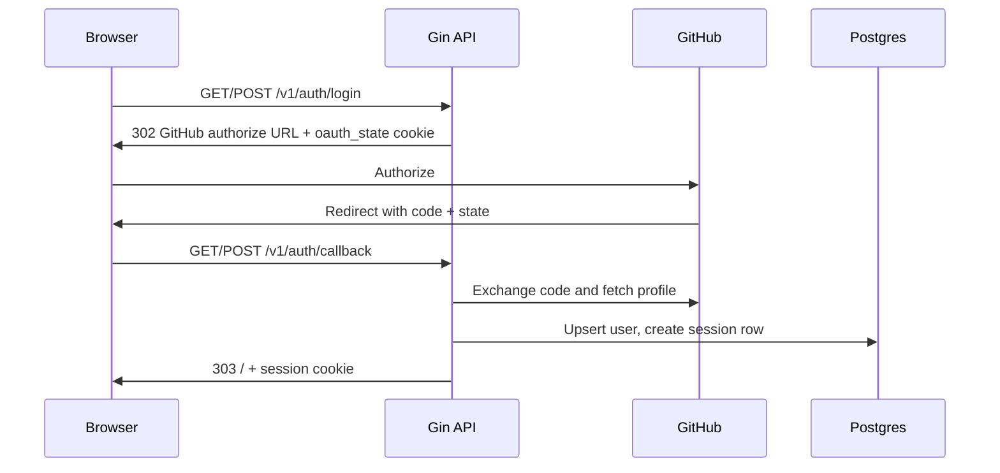
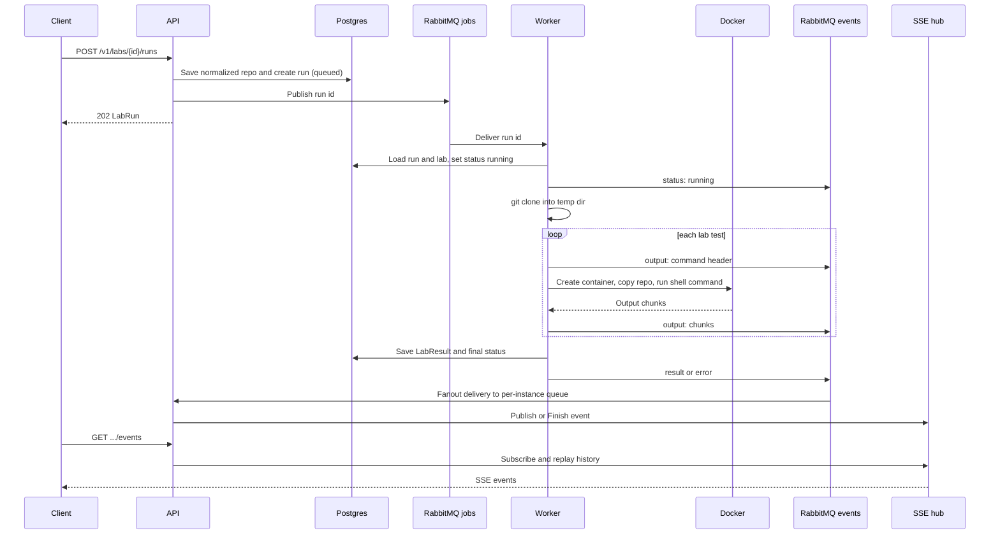

# Architecture

Docpine is an authenticated lab runner split into two services. The HTTP API handles identity, labs, and SSE delivery; a separate worker service consumes run jobs and owns all Docker interaction. RabbitMQ carries both jobs and execution events, and PostgreSQL stores durable state.

## Services

| Service | Entry point | Responsibility |
| --- | --- | --- |
| API | `cmd/docpine` | OAuth, user/profile, labs, repository, run and result endpoints, SSE event bridge |
| Worker | `cmd/docpine-worker` | Consume run jobs, clone repositories, execute lab commands, publish events |
| PostgreSQL | external | Users, sessions, labs, saved repos, runs, results |
| RabbitMQ | external | Durable job queue plus fanout exchange for live run events |
| Docker | worker host | One-shot isolated lab containers |

## Packages

| Component | Package | Responsibility |
| --- | --- | --- |
| HTTP handlers | `internal/handler` | OAuth, auth middleware, labs, runs, results, SSE endpoints |
| Middleware | `internal/middleware` | Request id, structured logging, CORS, Turnstile verification |
| Domain models | `internal/model` | `User`, `Session`, `Lab`, `UserRepo`, `LabRun`, `LabResult` |
| Persistence | `internal/repository` | SQL for users/sessions and labs/runs/results |
| Services | `internal/service` | Repo normalization, run creation, ownership checks, session parsing |
| Queue | `internal/queue` | Job publish/consume and event publish/fanout consume |
| Runner | `internal/runner` | One-shot Docker container creation, file copy, output streaming |
| Worker logic | `internal/worker` | Clone repository, execute lab commands, persist result, emit events |
| SSE hub | `internal/sse` | In-memory per-run event history and subscribers |
| Config/logging | `internal/config`, `pkg/logger` | Viper environment loading and slog handlers |

## Request and authentication flow

`RequireAuth` reads the `session` cookie, verifies its HMAC and expiry, resolves the GitHub id to a local user, and stores the database user id in the Gin context. All run and result reads are filtered by that user id.

## Run and event lifecycle

The worker never writes to the API's in-memory hub. The API consumes the event exchange for every run and mirrors events locally.

## Data model

| Table | Purpose | Key columns |
| --- | --- | --- |
| `users` | GitHub identity | `github_id`, `login`, `avatar_url` |
| `sessions` | Login audit rows | `user_id`, `token_hash`, `expires_at` |
| `labs` | Available labs and commands | `name`, `tests TEXT[]` |
| `user_repo` | User's saved repository | `user_id`, `github_repo` |
| `lab_run` | One execution attempt | `user_id`, `lab_id`, `github_repo`, `status` |
| `lab_result` | Persisted combined output | `run_id`, `results` |

Run status transitions are `queued` → `running` → `passed` or `failed`. Publish failures mark the run `failed`.

## RabbitMQ topology

| Resource | Type | Producer | Consumer |
| --- | --- | --- | --- |
| `RABBITMQ_QUEUE` | durable queue | API | Worker |
| `RABBITMQ_EVENTS_EXCHANGE` | durable fanout exchange | Worker | Every API instance |

Job messages are persistent JSON containing `run_id`. The worker uses `Qos(1)`, acknowledges successful runs, rejects malformed messages without requeue, and requeues handler errors. Event messages are JSON objects containing `run_id`, `type`, and `data`. Each API instance declares an exclusive auto-delete queue bound to the fanout exchange, so all replicas receive every event without competing for messages.

## Docker execution

Docker access exists only in the worker service. For each lab command the worker:

1. Ensures `LAB_RUNNER_IMAGE` exists locally, pulling it if necessary.
2. Creates a container with `WorkingDir=/tmp/workspace`, `NetworkMode=none`, memory and CPU limits.
3. Archives the cloned repository and uploads it with `CopyToContainer`, avoiding host bind paths.
4. Attaches to stdout/stderr, starts the container, streams output, and publishes chunks as events.
5. Removes the container with `Force: true` in a deferred cleanup.

A non-zero exit code stops the remaining commands and marks the run failed. The lab image must contain any language toolchains the commands require.

## SSE hub

The hub keeps a bounded history and a subscriber channel per run. Late subscribers receive replayed history before live events. A `ping` event is emitted every 25 seconds by the API. Slow subscribers are dropped rather than blocking the event bridge. Terminal `result` and `error` events call `Finish`, which appends the event and closes subscriber channels.

The hub is in-process only. Multiple API replicas each receive the full event stream from RabbitMQ, but replay history is per-replica. For complete replay across restarts, add a durable event log and rebuild hub history from it on demand.

## Security boundaries

- Browser clients never pass a user id; ownership is derived from the signed session cookie.
- GitHub state cookies are `HttpOnly`, `SameSite=Lax`, and expire after 10 minutes.
- Session cookies are `HttpOnly`, `SameSite=Lax`, last 7 days, and are `Secure` when `GITHUB_FORCE_SECURE=true`.
- CORS reflects only configured origins and allows credentials.
- Turnstile verification is applied to login and run creation when `TURNSTILE_SECRET` is set.
- Lab containers have no network access and limited memory/CPU.
- The API has no Docker client or socket mount. The worker container mounts the Docker socket, which is root-equivalent on the host; deploy it as trusted infrastructure.

## Failure handling

| Failure | Result |
| --- | --- |
| Invalid GitHub repo | `400` before run creation |
| Unknown lab | `404` from repository lookup |
| Queue publish error | Run marked `failed`, API returns `500` |
| Clone failure | Run completed as `failed` with clone output |
| Test command failure | Remaining tests skipped, run marked `failed` |
| Runner error | Run completed as `failed` with error text |
| Database error during completion | Message requeued by RabbitMQ |
| Event publish failure | Logged by worker; persisted run/result remains authoritative |

## Removed legacy design

The previous anonymous sandbox product used `internal/runtime`, `internal/session`, WebSockets, device cookies, rate limiters, proof-of-work, and `internal/transport`. Those packages are gone. Docker execution now lives in a dedicated worker service using `internal/runner`, streaming uses SSE via RabbitMQ fanout, and identity is GitHub OAuth based.
